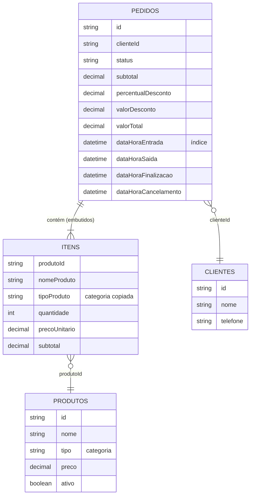
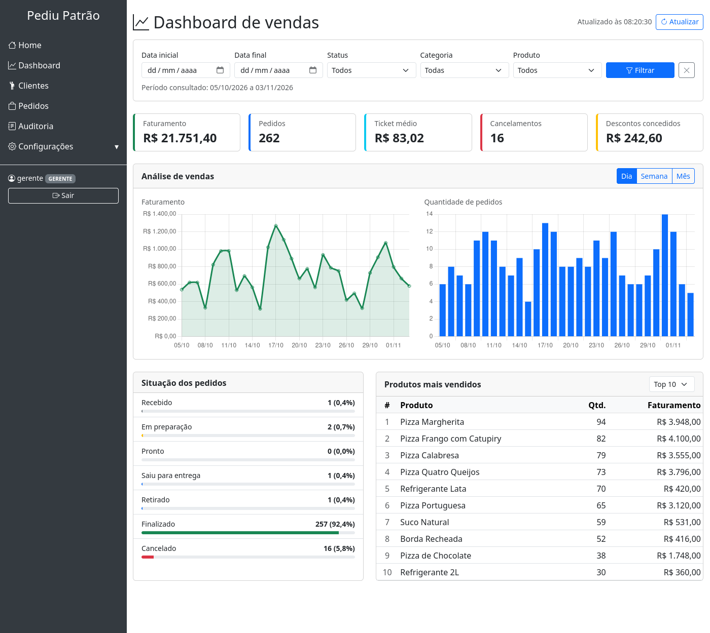
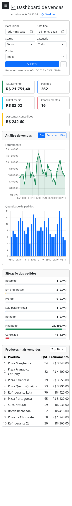

# Dashboard Administrativo

## Objetivo

O Dashboard Administrativo permite que o responsável pelo estabelecimento acompanhe o desempenho das vendas, visualize informações sobre os pedidos e identifique tendências da operação, auxiliando na tomada de decisões.

O painel faz parte do sistema Pediu Patrão e consome dados de uma API própria, integrada ao banco MongoDB já usado pelo sistema.

## Escopo

**Incluído:**

- Consulta de indicadores de vendas, gráficos, situação dos pedidos e produtos mais vendidos.
- Filtros de consulta aplicados a todas as informações do painel.
- Endpoints da API que fornecem esses dados.

**Fora do escopo:**

- Cadastro ou alteração de pedidos pelo painel. O dashboard é somente leitura.
- Exportação de relatórios.
- Comparação entre estabelecimentos. O sistema atende uma única pizzaria.

## Perfis de acesso

| Perfil    | Acesso ao dashboard | Justificativa                                           |
|-----------|---------------------|---------------------------------------------------------|
| ADMIN     | Permitido           | Administra o sistema e já consulta pedidos e auditoria. |
| GERENTE   | Permitido           | É o responsável pelo acompanhamento da operação.        |
| ATENDENTE | Negado (403)        | Sua função é registrar pedidos, não analisar vendas.    |

## Requisitos funcionais

### RF01 — Indicadores gerais de vendas

O dashboard deve apresentar, para o período consultado:

| Indicador          | Cálculo                                                 |
|--------------------|---------------------------------------------------------|
| Faturamento        | Soma do valor total dos pedidos não cancelados.         |
| Pedidos            | Quantidade de pedidos não cancelados.                   |
| Ticket médio       | Faturamento dividido pela quantidade de pedidos não cancelados. Sem pedidos, o valor é zero. |
| Cancelamentos      | Quantidade de pedidos cancelados.                       |
| Descontos          | Soma dos descontos concedidos nos pedidos não cancelados. |

### RF02 — Análise de vendas

O dashboard deve apresentar gráficos que mostrem a evolução das vendas no período consultado:

| Gráfico             | Tipo   | Dados                                            |
|---------------------|--------|--------------------------------------------------|
| Faturamento         | Linha  | Faturamento de cada intervalo de tempo.          |
| Quantidade de pedidos | Barras | Pedidos não cancelados de cada intervalo de tempo. |

O usuário deve poder agrupar os dados por dia, semana ou mês. Intervalos sem vendas devem aparecer com valor zero, para não esconder quedas na operação.

### RF03 — Situação dos pedidos

O dashboard deve apresentar a quantidade de pedidos em cada situação do fluxo, dentro do período consultado:

| Situação          | Significado                                  |
|-------------------|----------------------------------------------|
| Recebido          | Pedido registrado, aguardando o preparo.     |
| Em preparação     | Pedido sendo preparado.                      |
| Pronto            | Pedido pronto, aguardando a saída.           |
| Saiu para entrega | Pedido a caminho do cliente.                 |
| Retirado          | Pedido retirado pelo cliente.                |
| Finalizado        | Pedido concluído.                            |
| Cancelado         | Pedido cancelado pelo gerente.               |

Situações sem pedidos devem aparecer com quantidade zero.

### RF04 — Produtos mais vendidos

O dashboard deve apresentar o ranking dos produtos mais vendidos no período consultado, com nome, quantidade vendida e faturamento de cada produto. O ranking é ordenado pela maior quantidade e, em caso de empate, pelo maior faturamento. O usuário pode definir quantos produtos aparecem, de 1 a 50, sendo 10 o padrão.

### RF05 — Filtros de consulta

O usuário deve poder filtrar todas as informações do dashboard por:

| Filtro    | Comportamento                                                  |
|-----------|----------------------------------------------------------------|
| Período   | Data inicial e data final, ambas incluídas. Sem preenchimento, considera os últimos 30 dias. |
| Status    | Apenas pedidos na situação escolhida.                          |
| Produto   | Apenas pedidos que contenham o produto escolhido.              |
| Categoria | Apenas pedidos que contenham produtos da categoria escolhida.  |

Os filtros podem ser combinados. A data inicial não pode ser posterior à data final.

### RF06 — Integração com a API

O dashboard deve obter todos os dados pelos endpoints da API, descritos neste documento, sem receber valores calculados diretamente no HTML da página. A API deve consultar o banco MongoDB do sistema e responder em JSON.

### RF07 — Atualização e tratamento de dados

**Atualização:**

- Os dados são atualizados automaticamente a cada 60 segundos e também por um botão.
- A atualização mantém os filtros escolhidos.
- A tela informa o horário da última atualização.

**Tratamento na tela:**

- Enquanto carrega, a tela mostra um indicador de carregamento.
- Sem dados no período, a tela mostra uma mensagem em vez de gráficos vazios.
- Em caso de erro, a tela mostra a mensagem recebida e mantém os últimos dados carregados.
- Com a sessão expirada, o usuário vai para o login. Sem permissão, vai para a página de acesso negado.

**Tratamento na API:**

- Filtros inválidos são recusados com uma mensagem de erro.
- Períodos sem pedidos retornam valores zerados ou listas vazias, não erro.
- Pedidos antigos são tratados conforme as regras de negócio abaixo.

## Regras de negócio

| Código | Regra |
|--------|-------|
| RN01   | Pedidos cancelados não entram no faturamento, na quantidade de pedidos, no ticket médio, nos descontos, nos gráficos de vendas nem no ranking. Eles aparecem apenas no indicador de cancelamentos e na situação dos pedidos. |
| RN02   | O período é aplicado sobre a data e hora de entrada do pedido, no horário local do estabelecimento. |
| RN03   | A semana começa na segunda-feira. |
| RN04   | Os valores monetários têm duas casas decimais. O ticket médio é arredondado para cima a partir da metade do centavo. |
| RN05   | O faturamento de um pedido é o valor total, já com desconto. No ranking, o faturamento de um produto é a soma dos subtotais dos seus itens, sem o desconto, que é aplicado sobre o pedido inteiro. |
| RN06   | Com o filtro de produto ou de categoria, os indicadores e gráficos consideram o pedido inteiro, e o ranking considera apenas os itens que atendem ao filtro. |
| RN07   | A categoria do produto é copiada para o item no registro do pedido, preservando o histórico. Em pedidos antigos, é obtida pelo cadastro do produto. Itens cujo produto não existe mais não atendem ao filtro de categoria. |
| RN08   | Status de versões antigas são convertidos: `EM_PREPARO` para Em preparação e `ENTREGUE` para Finalizado. Valores ausentes em pedidos antigos são considerados zero, e pedidos sem data de entrada ficam fora das consultas. |

## Requisitos não funcionais

| Código | Categoria        | Requisito |
|--------|------------------|-----------|
| RNF01  | Segurança        | Somente os perfis ADMIN e GERENTE acessam o dashboard. A regra é aplicada no backend: o perfil ATENDENTE recebe 403, e requisições sem login recebem 401. |
| RNF02  | Privacidade      | Os endpoints do dashboard não retornam dados pessoais de clientes. |
| RNF03  | Desempenho       | Cada endpoint responde em até 2 segundos com 5.000 pedidos no período consultado, com índice na data de entrada do pedido. |
| RNF04  | Confiabilidade   | Todos os valores são calculados no servidor, com tipo decimal, a partir dos dados gravados. |
| RNF05  | Usabilidade      | A tela funciona em computador e celular e exibe valores em reais e datas no formato brasileiro. |
| RNF06  | Compatibilidade  | A solução usa a mesma base do sistema: Java 21, Spring Boot 3.4, Spring Security, Thymeleaf e MongoDB. Os gráficos usam Chart.js. |
| RNF07  | Manutenibilidade | O código segue a separação em controller, service e repository e tem testes automatizados de cálculos, filtros, permissões e erros. |

## Modelagem de dados

O dashboard não cria coleções novas: ele lê os dados que o sistema já grava no MongoDB.



| Coleção    | Uso no dashboard |
|------------|------------------|
| `pedidos`  | Fonte de todos os indicadores, gráficos, situações e do ranking. Os itens ficam embutidos no próprio pedido. |
| `produtos` | Opções do filtro de produto e de categoria, e categoria de itens de pedidos antigos (RN07). |
| `clientes` | Não é consultada pelo dashboard (RNF02). |
| `usuarios` | Login e perfil de acesso (RNF01). |

Exemplo simplificado de pedido gravado, sem os campos de responsável e os demais horários:

```json
{
  "_id": "6ae9c2d8c0920c1c23cd9d01",
  "clienteId": "6ae9c2d7c0920c1c23cd9cf0",
  "status": "FINALIZADO",
  "itens": [
    { "produtoId": "6ae9c2d7c0920c1c23cd9ce2", "nomeProduto": "Pizza Calabresa", "tipoProduto": "Pizza",
      "quantidade": 1, "precoUnitario": "45.00", "subtotal": "45.00" },
    { "produtoId": "6ae9c2d7c0920c1c23cd9ce9", "nomeProduto": "Refrigerante 2L", "tipoProduto": "Bebida",
      "quantidade": 1, "precoUnitario": "12.00", "subtotal": "12.00" }
  ],
  "subtotal": "57.00",
  "percentualDesconto": "10.00",
  "valorDesconto": "5.70",
  "valorTotal": "51.30",
  "dataHoraEntrada": "2026-10-24T20:15:00"
}
```

Todas as consultas do dashboard começam pelo período, por isso a coleção `pedidos` tem um índice em `dataHoraEntrada` (criado em `MongoInitConfig`). A API busca os pedidos do período por esse índice e aplica os filtros de status, produto e categoria no serviço, onde também são feitas as somas.

## Decisões de análise e projeto

| Decisão | Motivo |
|---------|--------|
| Usar a mesma base do sistema (Spring Boot, Spring Security, Thymeleaf e MongoDB), sem criar outro serviço. | O dashboard reaproveita o login, os perfis e os dados que já existem, sem duplicar informação nem manter outra aplicação (RNF06). |
| Manter os itens embutidos no pedido e copiar a categoria para cada item. | Um pedido é lido de uma vez, sem junções, e alterar a categoria de um produto depois não muda o histórico de vendas (RN07). |
| Criar índice em `dataHoraEntrada`. | É o único critério presente em todas as consultas (RN02, RNF03). |
| Fazer os cálculos no serviço Java, com `BigDecimal`. | As regras ficam em um só lugar e cobertas por testes, inclusive a conversão de pedidos antigos (RN04, RN08, RNF04, RNF07). Com os 750 pedidos do perfil `demo`, cada endpoint respondeu em cerca de 0,17 s, incluindo a verificação de senha. Se o volume crescer muito, as somas podem passar para o *aggregation pipeline* do MongoDB sem mudar os endpoints. |
| Deixar pedidos cancelados fora do faturamento, dos gráficos e do ranking. | O faturamento deve refletir a receita real. Os cancelamentos continuam visíveis em um indicador próprio e na situação dos pedidos (RN01). |
| Separar a API em quatro endpoints com os mesmos filtros. | Cada endpoint tem um contrato simples e corresponde a uma área da tela, e a mesma validação de filtros vale para todos (RF05, RF06). |
| Dashboard somente leitura e restrito a ADMIN e GERENTE no backend. | Esconder botões não protege a API. A regra fica no `SecurityConfig` e vale também para chamadas diretas (RNF01). |
| A tela busca os dados pela API em vez de recebê-los prontos no HTML. | Atende ao RF06 e permite atualizar os dados sem recarregar a página (RF07). |
| Gerar pedidos de exemplo apenas no perfil `demo`. | Permite demonstrar o dashboard com dados realistas sem alterar o comportamento normal do sistema. |

## Documentação dos endpoints

Os endpoints exigem login, por sessão do navegador ou HTTP Basic, e aceitam apenas `GET`.

### Parâmetros comuns

Os parâmetros são opcionais e valem para todos os endpoints.

| Parâmetro   | Tipo                  | Descrição                                                                       |
|-------------|-----------------------|---------------------------------------------------------------------------------|
| `de`        | Data (`AAAA-MM-DD`)   | Data inicial. Padrão: 29 dias antes da data final.                              |
| `ate`       | Data (`AAAA-MM-DD`)   | Data final. Padrão: hoje.                                                       |
| `status`    | Texto                 | `RECEBIDO`, `EM_PREPARACAO`, `PRONTO`, `SAIU_PARA_ENTREGA`, `RETIRADO`, `FINALIZADO` ou `CANCELADO`. |
| `produtoId` | Texto                 | ID do produto.                                                                  |
| `tipo`      | Texto                 | Categoria do produto, como `Pizza` ou `Bebida`.                                 |

### Possíveis erros

Com exceção do 401, os erros retornam JSON no formato `{"erro": "mensagem"}`.

| Status | Quando ocorre                      | Exemplo de mensagem                                                |
|--------|------------------------------------|--------------------------------------------------------------------|
| 400    | Parâmetro em formato inválido      | `Valor inválido para o parâmetro 'status'.`                        |
| 401    | Requisição sem login               | Resposta sem corpo                                                 |
| 403    | Perfil sem permissão               | `Acesso negado: seu perfil não tem permissão para esta operação.`  |
| 422    | Valores que violam as regras       | `A data inicial não pode ser posterior à data final.`              |

### GET `/api/dashboard/indicadores`

Retorna os indicadores gerais de vendas (RF01).

```bash
curl -u gerente:teste123 "http://localhost:8080/api/dashboard/indicadores?de=2026-10-01&ate=2026-10-31"
```

Resposta `200`:

```json
{
  "faturamento": 1250.50,
  "pedidos": 30,
  "ticketMedio": 41.68,
  "cancelamentos": 2,
  "descontos": 35.00
}
```

### GET `/api/dashboard/vendas`

Retorna os dados dos gráficos de vendas (RF02).

Parâmetro adicional:

| Parâmetro     | Tipo  | Descrição                                     |
|---------------|-------|-----------------------------------------------|
| `agrupamento` | Texto | `DIA`, `SEMANA` ou `MES`. Padrão: `DIA`.      |

O campo `periodo` da resposta traz a data no agrupamento por dia, a data da segunda-feira no agrupamento por semana e `AAAA-MM` no agrupamento por mês.

```bash
curl -u gerente:teste123 "http://localhost:8080/api/dashboard/vendas?de=2026-10-01&ate=2026-10-02&agrupamento=DIA"
```

Resposta `200`:

```json
{
  "agrupamento": "DIA",
  "pontos": [
    { "periodo": "2026-10-01", "faturamento": 412.00, "pedidos": 9 },
    { "periodo": "2026-10-02", "faturamento": 0.00, "pedidos": 0 }
  ]
}
```

### GET `/api/dashboard/status`

Retorna a quantidade de pedidos em cada situação (RF03). As sete situações sempre aparecem; o exemplo abaixo está resumido.

```bash
curl -u gerente:teste123 "http://localhost:8080/api/dashboard/status?de=2026-10-01&ate=2026-10-31"
```

Resposta `200`:

```json
[
  { "status": "RECEBIDO", "descricao": "Recebido", "quantidade": 3 },
  { "status": "EM_PREPARACAO", "descricao": "Em preparação", "quantidade": 0 },
  { "status": "CANCELADO", "descricao": "Cancelado", "quantidade": 2 }
]
```

### GET `/api/dashboard/produtos-mais-vendidos`

Retorna o ranking de produtos (RF04).

Parâmetro adicional:

| Parâmetro | Tipo   | Descrição                                                                 |
|-----------|--------|---------------------------------------------------------------------------|
| `limite`  | Número | Quantidade de produtos, de 1 a 50. Padrão: 10. Fora dessa faixa, retorna 422. |

```bash
curl -u gerente:teste123 "http://localhost:8080/api/dashboard/produtos-mais-vendidos?de=2026-10-01&ate=2026-10-31&limite=2"
```

Resposta `200`:

```json
[
  { "produtoId": "6721f0a1c3", "nome": "Pizza Calabresa", "quantidade": 18, "faturamento": 810.00 },
  { "produtoId": "6721f0a1c4", "nome": "Refrigerante 2L", "quantidade": 12, "faturamento": 144.00 }
]
```

## Tela do dashboard

A tela fica em `/dashboard`, no menu lateral, e segue o mesmo layout das demais páginas do sistema (Thymeleaf e Bootstrap). Os dados são buscados pelo JavaScript (`static/js/dashboard.js`) nos quatro endpoints acima, e os gráficos usam Chart.js.

| Área da tela              | Requisito | Endpoint                                   |
|---------------------------|-----------|--------------------------------------------|
| Filtros                   | RF05      | Opções de produto e categoria em `GET /api/produtos` |
| Cards de indicadores      | RF01      | `/api/dashboard/indicadores`              |
| Gráficos de faturamento e pedidos, por dia, semana ou mês | RF02 | `/api/dashboard/vendas` |
| Situação dos pedidos      | RF03      | `/api/dashboard/status`                   |
| Produtos mais vendidos (Top 5, 10 ou 20) | RF04 | `/api/dashboard/produtos-mais-vendidos` |

Comportamento do RF07 na tela:

- Atualização automática a cada 60 segundos, pausada quando a aba não está visível, e pelo botão **Atualizar**. O horário da última atualização aparece no topo.
- A atualização usa os filtros aplicados pelo botão **Filtrar**, e não valores digitados e ainda não aplicados.
- Durante a carga aparece um indicador e os cards ficam esmaecidos. Uma nova carga não começa enquanto outra está em andamento.
- Sem pedidos no período, a tela mostra uma mensagem no lugar dos gráficos e do ranking.
- Em caso de erro, a mensagem da API aparece no topo e os últimos dados continuam na tela, com o horário em que foram carregados.
- As chamadas enviam o cabeçalho `X-Requested-With: XMLHttpRequest`. Assim, com a sessão expirada, a API responde 401 sem pedir senha ao navegador, e a tela leva o usuário ao login. Com 403, leva à página de acesso negado.
- Textos vindos da API são inseridos com `textContent`, nunca como HTML.

### Dados de exemplo

Com o perfil `demo` (`sh ./mvnw spring-boot:run -Dspring-boot.run.profiles=demo`), um banco sem pedidos recebe clientes, produtos e cerca de 750 pedidos dos últimos 90 dias, com picos no almoço e no jantar, descontos, cancelamentos e pedidos em andamento no dia atual. Os valores seguem as mesmas regras do registro de pedidos: o total é o subtotal menos o desconto. Sem o perfil, nada é criado.

## Evidências de testes

### Testes automatizados

Executados com `sh ./mvnw test`: 100 testes, nenhuma falha. Os testes não dependem do MongoDB: os serviços usam repositórios simulados (Mockito) e os controllers usam `@WebMvcTest` com o `SecurityConfig` real.

| Classe de teste                               | Testes | O que verifica |
|-----------------------------------------------|--------|----------------|
| `DashboardIndicadoresServiceTest`             | 4      | Faturamento, pedidos, ticket médio, cancelamentos e descontos; pedidos antigos sem valores contam como zero (RF01, RN01, RN04, RN08) |
| `DashboardVendasServiceTest`                  | 4      | Agrupamento por dia, semana e mês, com intervalos zerados e sem cancelados (RF02, RN01, RN03) |
| `DashboardSituacaoServiceTest`                | 1      | Todas as situações aparecem, inclusive com zero (RF03) |
| `DashboardProdutosServiceTest`                | 7      | Ordenação do ranking, desempate, limite e filtros por item (RF04, RN05, RN06) |
| `DashboardConsultaServiceTest`                | 7      | Período padrão, validação de datas, filtros e pedidos antigos (RF05, RN02, RN07, RN08) |
| `DashboardControllerTest`                     | 10     | Respostas JSON dos endpoints e erros 400 e 422 (RF06, RF07) |
| `DashboardPermissoesTest`                     | 5      | 401 sem login, 401 sem pedir senha nas chamadas da tela, 403 para ATENDENTE, apenas GET (RNF01) |
| `DashboardPaginaTest`                         | 3      | Acesso à página `/dashboard` por perfil |
| `GeradorPedidosDemoTest`                      | 7      | Consistência dos pedidos de exemplo |
| Demais classes do sistema                     | 52     | Pedidos, clientes, usuários, auditoria e permissões |

### Testes da API com o sistema em execução

Executados em 03/11/2026 com o MongoDB local e os dados do perfil `demo`. Sem datas, o período é de 05/10/2026 a 03/11/2026.

**Indicadores (RF01)**

```bash
curl -u gerente:teste123 "http://localhost:8080/api/dashboard/indicadores"
```

```json
{
  "faturamento": 21751.40,
  "pedidos": 262,
  "ticketMedio": 83.02,
  "cancelamentos": 16,
  "descontos": 242.60
}
```

**Indicadores filtrados pela categoria Pizza (RF05, RN06)**

```bash
curl -u gerente:teste123 "http://localhost:8080/api/dashboard/indicadores?tipo=Pizza"
```

```json
{
  "faturamento": 20841.60,
  "pedidos": 214,
  "ticketMedio": 97.39,
  "cancelamentos": 13,
  "descontos": 231.40
}
```

**Vendas por mês nos últimos 90 dias (RF02)**

```bash
curl -u gerente:teste123 "http://localhost:8080/api/dashboard/vendas?de=2026-08-06&ate=2026-11-03&agrupamento=MES"
```

```json
{
  "agrupamento": "MES",
  "pontos": [
    {
      "periodo": "2026-08",
      "faturamento": 17383.30,
      "pedidos": 187
    },
    {
      "periodo": "2026-09",
      "faturamento": 17748.20,
      "pedidos": 218
    },
    {
      "periodo": "2026-10",
      "faturamento": 23038.15,
      "pedidos": 275
    },
    {
      "periodo": "2026-11",
      "faturamento": 2040.85,
      "pedidos": 23
    }
  ]
}
```

**Ranking com limite 3 (RF04)**

```bash
curl -u gerente:teste123 "http://localhost:8080/api/dashboard/produtos-mais-vendidos?limite=3"
```

```json
[
  {
    "produtoId": "6ae9c2d7c0920c1c23cd9ce3",
    "nome": "Pizza Margherita",
    "quantidade": 94,
    "faturamento": 3948.00
  },
  {
    "produtoId": "6ae9c2d7c0920c1c23cd9ce8",
    "nome": "Pizza Frango com Catupiry",
    "quantidade": 82,
    "faturamento": 4100.00
  },
  {
    "produtoId": "6ae9c2d7c0920c1c23cd9ce2",
    "nome": "Pizza Calabresa",
    "quantidade": 79,
    "faturamento": 3555.00
  }
]
```

**Erros e permissões (RF07, RNF01)**

| Requisição | Status | Resposta |
|------------|--------|----------|
| `indicadores?de=2026-11-03&ate=2026-10-05` (datas invertidas) | 422 | `"erro": "A data inicial não pode ser posterior à data final."` |
| `indicadores?status=VOANDO` | 400 | `"erro": "Valor inválido para o parâmetro 'status'."` |
| `produtos-mais-vendidos?limite=99` | 422 | `"erro": "O limite deve estar entre 1 e 50."` |
| Sem login, com `X-Requested-With` | 401 | Sem corpo |
| Usuário `atendente` | 403 | `"erro": "Acesso negado: seu perfil não tem permissão para esta operação."` |
| `indicadores?de=2020-01-01&ate=2020-01-31` (sem pedidos) | 200 | Todos os valores zerados |

### Tela em funcionamento

Usuário `gerente`, últimos 30 dias, dados do perfil `demo`.



No celular, os blocos ficam um abaixo do outro:


